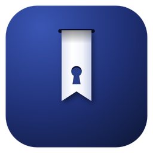
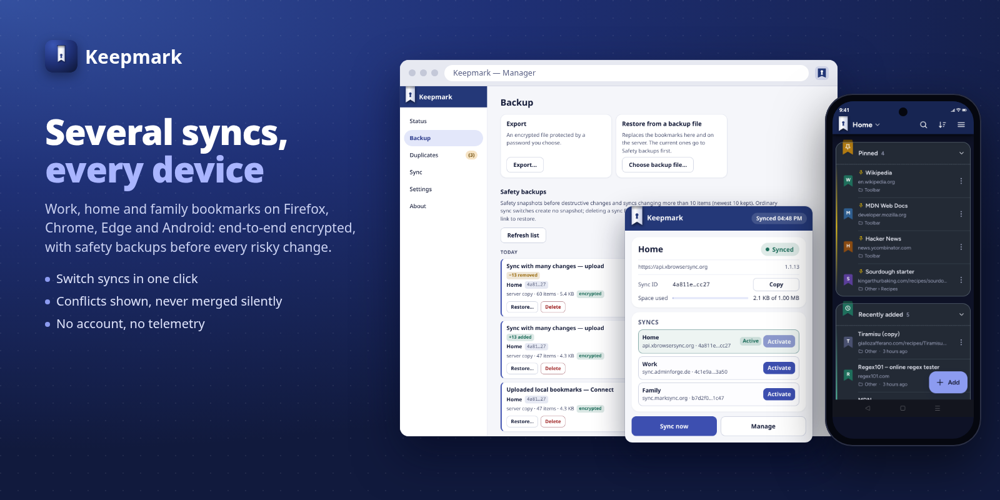
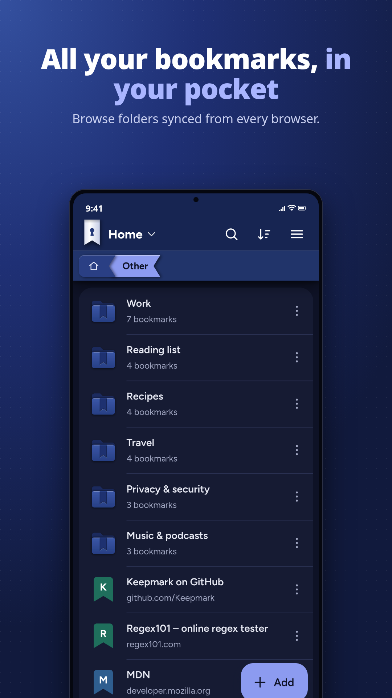
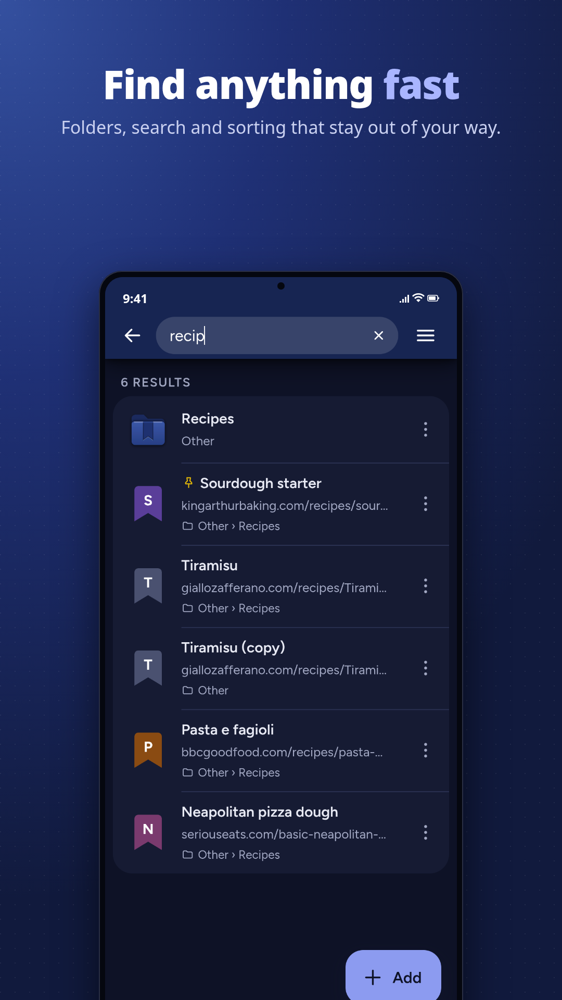
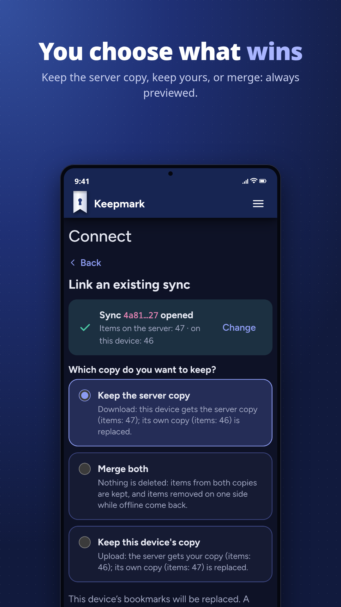
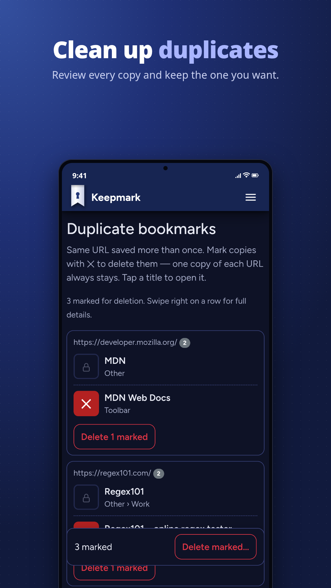
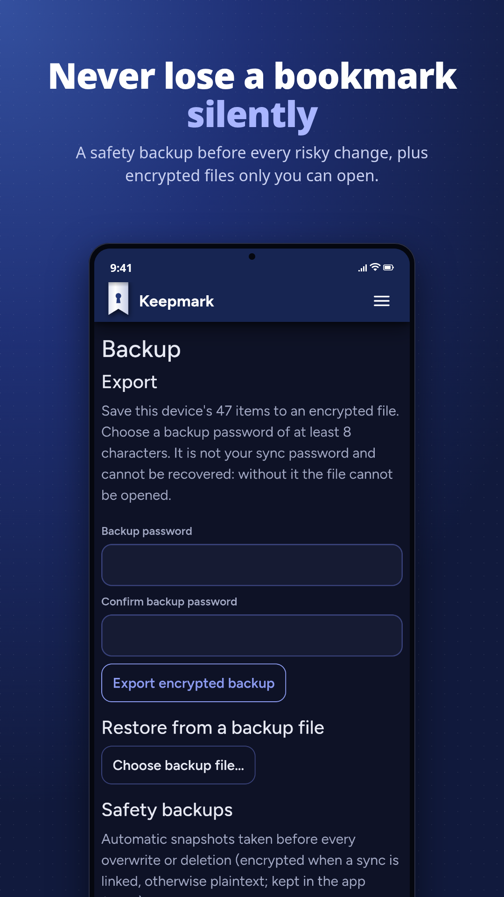
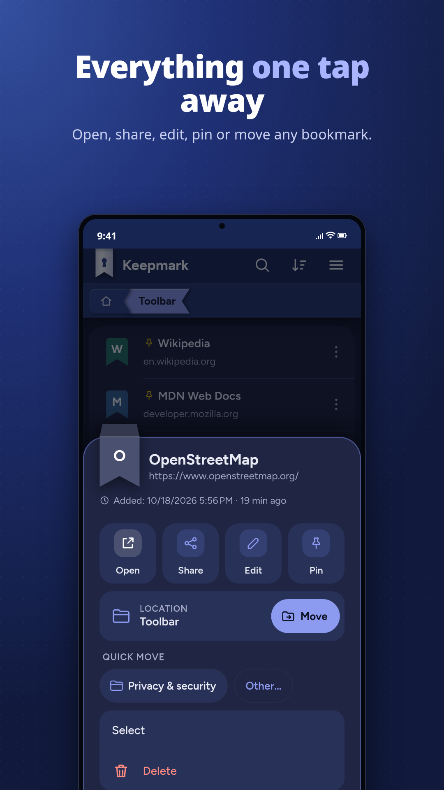
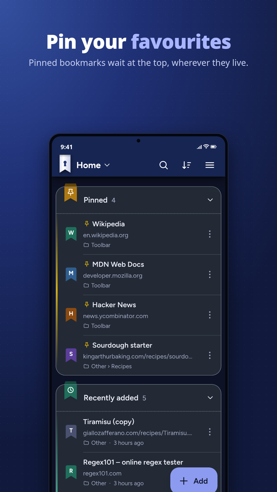
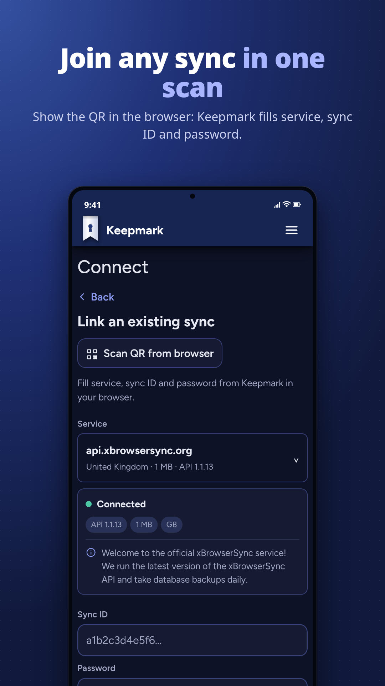

  

<h1 align="center">Keepmark for Android</h1>

  <b>All your bookmark syncs on your phone: work, home, family.</b> 
  Switch in a tap, end-to-end encrypted, and nothing is ever lost silently.

  
  
  

  

---

Keepmark keeps your bookmarks in sync between your phone and your browsers,
and lets the phone hold **several independent syncs**. Work, home, a shared
family collection, a test server: each keeps its own password and bookmarks,
and you switch between them in a tap. Everything is encrypted on the device
before it leaves, and every risky change leaves a way back.

## Why Keepmark

- **Multi-sync, built in.** Several syncs saved on the phone, exactly one
  active. From the bookmark list, tap the sync's name in the top bar to
  switch from a sheet of coloured ribbons. In Syncs each row shows **Activate** first; rarer commands live in its **⋮**
  menu, with unlinking kept apart at the bottom. Switching saves pending edits
  first and stops on a conflict or failed save instead of losing anything.
- **Private by design.** PBKDF2-SHA256 and AES-GCM on the device. The local
  database is encrypted too (SQLCipher), and the credentials live in the
  Android KeyStore. Optional app lock with fingerprint or device PIN. No
  telemetry; HTTPS by default, plain HTTP only as an explicit, warned choice.
- **Fault tolerant.** Before anything replaces your bookmarks Keepmark keeps
  an encrypted safety backup you can restore in one tap. Conflicts are never
  resolved behind your back, single deletes have Undo, and a sync that
  disappears from its server leaves you a verified local copy.
- **One scan from your browser.** The Keepmark browser manager shows a
  connection QR: scan it here and the service, sync ID and password arrive
  together, ready to review. Nothing from the QR is saved.

## Never lose a bookmark silently

- **Safety backups.** Before a destructive change (taking the server copy,
  restoring a backup, deleting a selection or duplicates, changing password)
  and before any sync that changes more than 10 items, Keepmark stores an
  encrypted snapshot of what is replaced. The newest 10 are kept.
- **Conflicts are a choice, not a guess.** You pick download, upload or
  merge, and merge shows a preview first.
- **Safe switching.** The sync you leave is saved before the next one is
  activated; if that save fails, nothing is replaced.
- **A sync that disappears does not take your bookmarks with it.** If the
  service no longer has your sync (it expired, or another device deleted it),
  Keepmark says so instead of guessing. Unlink and keep a verified local copy,
  then restore it whenever you want.
- **Undo and second thoughts.** Single deletes have Undo; deleting a folder
  with 5 or more bookmarks asks first.
- **Encrypted backups you own.** Export a password-protected file at any time
  and restore it here or in the browser.

## Made for the phone

- **Fast to find.** Full-text search, pinned bookmarks, recently added on
  Home, a clickable breadcrumb, folders first.
- **Fast to act.** Swipe for details, one menu for every action; hold an item
  to select several and move or delete them together.
- **Share to Keepmark** from any app: the add form opens already filled in.
- **Status at a glance.** A compact Status screen with sync state, counts,
  server storage and versions.

## Features

| | |
|---|---|
| **Sync** | Automatic while the app is open, plus Sync now, with clear status and honest conflict handling |
| **Link a browser** | Scan the connection QR from the Keepmark browser manager; the service is reviewed before linking |
| **Select many** | Hold an item to select it, tap more rows or All, then move or delete the selection together |
| **Choose a service** | Eight public services with country, size limit and API version, plus the custom URLs that worked before |
| **Browse** | Search, pinned and recently added sections, breadcrumb, folder tree picker |
| **Edit** | Add, edit, move and delete bookmarks and folders, with undo; new folder right from the picker; "already saved" hint when you add a page you have |
| **Backup** | Encrypted export and import, compatible with Keepmark for browsers |
| **Safety backups** | Snapshots before destructive operations and sync changes affecting more than 10 nodes (newest 10 kept); switching between linked syncs saves the old sync first |
| **Duplicates** | Find links saved more than once; one copy of each always survives |
| **Syncs** | Keep several syncs on the phone with one active at a time; switching saves pending edits first and stops on conflicts or failed saves. Rename or forget a saved sync, or add an existing sync with its ID and password (or the browser QR) |
| **Removed syncs** | If a sync disappears from its service, unlink and keep a verified local copy you can restore or delete from Backup (a restore while another sync is linked waits until that sync has saved its edits) |
| **Look and feel** | Light, dark or system theme; English, Italiano, Français, Español, Deutsch, 日本語, Português (Brasil), Русский, 简体中文, Română |
| **Logs** | Built-in viewer with share export, sync IDs and secrets redacted |

All three bookmark containers — Menu, Other and Toolbar — synchronize together.
The phone has no server-side sync deletion action; targeted operations on saved
syncs in the browser manager are browser features.

## Link a browser by QR

Bringing a browser onto this phone's sync normally means typing the service, the
sync ID and the password. If you have the Keepmark browser extension, one scan is
enough:

1. In the Keepmark browser manager, the Android card says **Connect Keepmark on
   your phone**; choose **Show connection QR** and verify the sync password there.
2. On Android, open **Connect → Link an existing sync → Scan QR from browser**
   (the same QR button is in **Syncs → + Add a sync** when a sync is already
   active).
3. Check the service and abbreviated sync ID the review shows, tap **Continue**,
   wait for verification, then choose the direction.

The QR contains your credentials, password included, so show it only to your own
device. The browser erases it after 60 seconds or when it loses focus, and this
app discards an unused scan after 60 seconds or when it goes to the background:
nothing from the QR is written to storage or to the log, and no image is kept.
The camera is used only while you are scanning. Manual linking stays available.

## Organize several items

Hold an item to select it, then tap others or choose All. Move them together to an
existing or newly created folder, with a short Undo window. Delete shows the affected
folder contents before confirmation and keeps a safety backup in Backup → Safety
backups. A brief touch response and visible checkboxes confirm selection.

## Screenshots

  
  
  
  

  
  
  
  

## The Keepmark family

| | |
|---|---|
| **Keepmark for Android** | This app (Android 10+) |
| **Keepmark for browsers** | Extension for Firefox and Chromium-based browsers (Chrome, Edge, Brave): [Firefox Add-ons](https://addons.mozilla.org/en-US/firefox/addon/keepmark/), [Chrome Web Store](https://chromewebstore.google.com/detail/jaaekkbgpeiikepahjelfbkfgpjphbhb) |
| **Keepmark Server** | Self-hostable sync service with atomic writes and revisions, compatible with existing xBrowserSync services |

All three share the same encryption, the same backup format and the same
wording, so moving between them feels the same.

## Compatibility

Keepmark builds on the open xBrowserSync protocol, so it needs no new
infrastructure: it runs on any xBrowserSync service (the official one, a
community host or your own) and syncs open both ways with the official
xBrowserSync apps. On **Keepmark Server** it also uses revision-based conflict
detection and cheap change checks; elsewhere it falls back automatically.

- **Services:** any xBrowserSync API service, version 1.1.9 or later.
  HTTPS is the default; a self-hosted service over plain HTTP is an explicit,
  warned choice.
- **Clients:** syncs open both ways with the official xBrowserSync apps
  (sync format 1.8.0). The encryption is verified byte for byte against the
  official implementation.
- **Device:** Android 10 (API 29) or later.

## Get it

**Google Play (closed testing).** Keepmark is in closed testing on Google
Play and testers are welcome:

1. Join the [keepmark-testers](https://groups.google.com/g/keepmark-testers)
   group with the Google account you use on Play Store.
2. Opt in to the test:
   <https://play.google.com/apps/testing/com.keepmark.mobile>
3. Install from
   [Google Play](https://play.google.com/store/apps/details?id=com.keepmark.mobile).

Please keep the app installed for at least 14 days. Feedback is welcome in
[issues](https://github.com/Keepmark/KeepmarkMobile/issues) or at
keepmark@proton.me.

Release notes for every version are on the
[Releases](https://github.com/Keepmark/KeepmarkMobile/releases) page.
Project home: <https://github.com/Keepmark>.

## Documentation

- [Developer guide](docs/DEVELOPMENT.md): build environment, architecture,
  engineering rules, safety-backup specification.
- [Verification spec](docs/verification-spec.md): behavioural requirements
  for code review.
- [Workflows](docs/WORKFLOWS.md) and [UI terms](docs/UI-TERMS.md): shared
  with Keepmark for browsers.

## Feedback

Questions, bug reports and ideas: [open an issue](../../issues).

## License

Proprietary — © 2026 Yari Melzani, all rights reserved. See
[`LICENSE.md`](LICENSE.md).

Independent implementation, written from scratch; compatible with the
xBrowserSync protocol. Not affiliated with or endorsed by xBrowserSync.

Third-party notices: `Crypto/LzUtf8.cs` is a C# port of `lzutf8` (MIT,
© Rotem Dan, notice kept in the file); BouncyCastle (MIT); SQLCipher Community
(BSD-style), SQLite (public domain), LibTomCrypt (public-domain option). See
[SQLCipher notices](native/sqlcipher/THIRD-PARTY-NOTICES.txt), also bundled in the app.

## Disclaimer

Keepmark is provided "as is", without warranty of any kind, express or
implied, including the implied warranties of merchantability and fitness for
a particular purpose. Use it at your own risk: the authors are not liable for
any loss of data (including bookmarks), damage or other consequences arising
from its use. See `LICENSE.md`. Keep your own backups.
