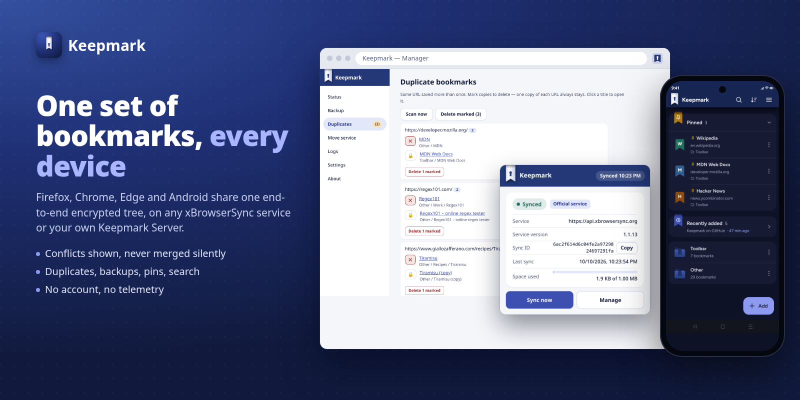
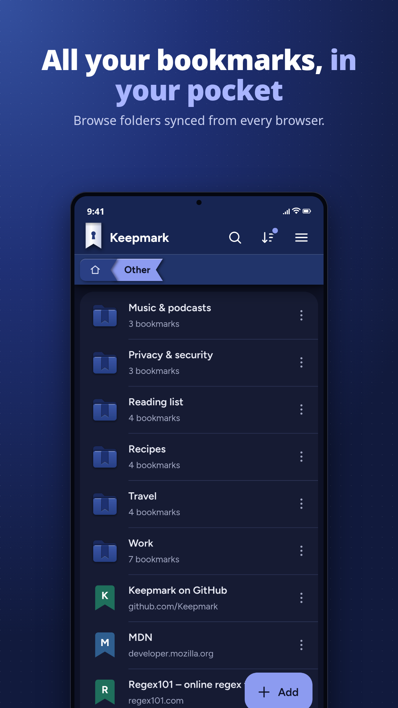
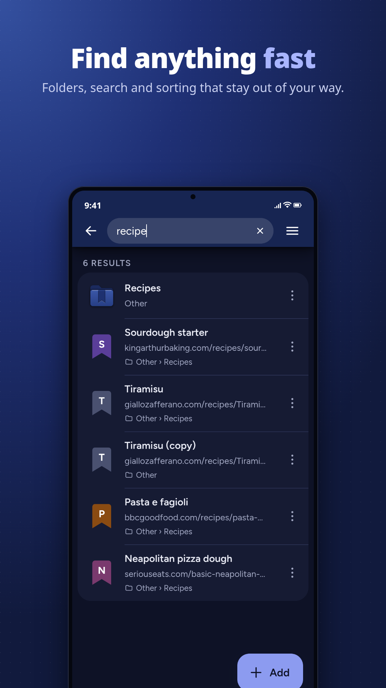
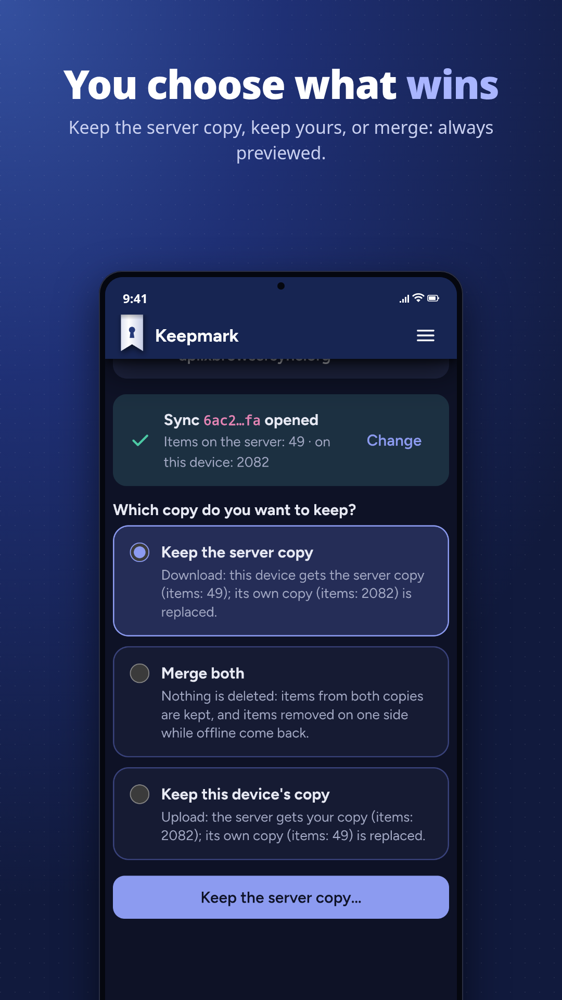
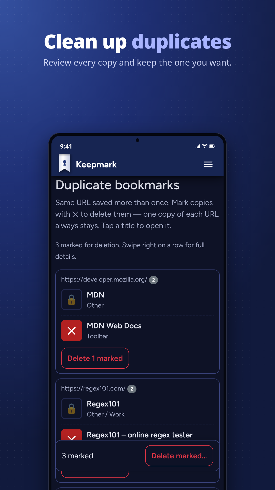
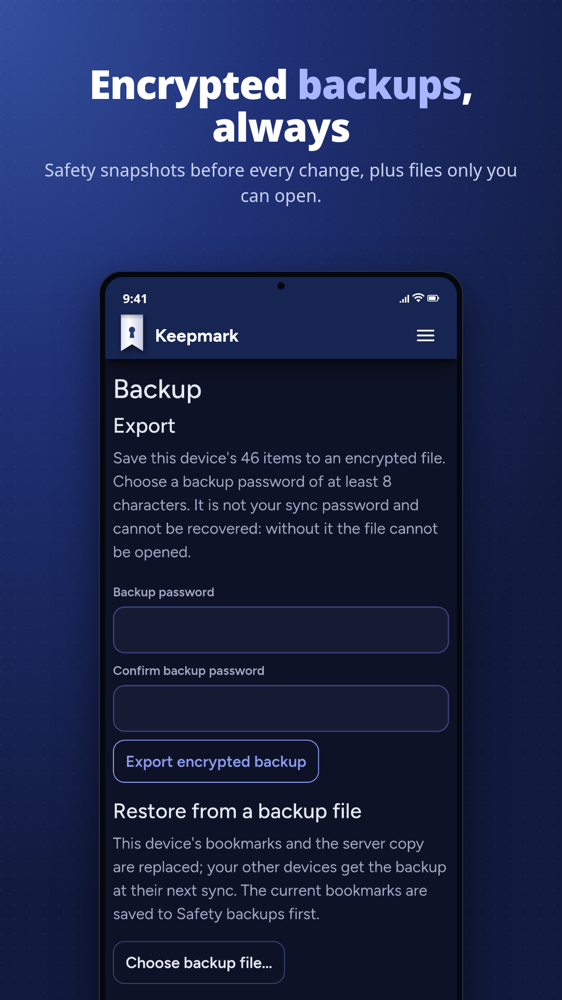
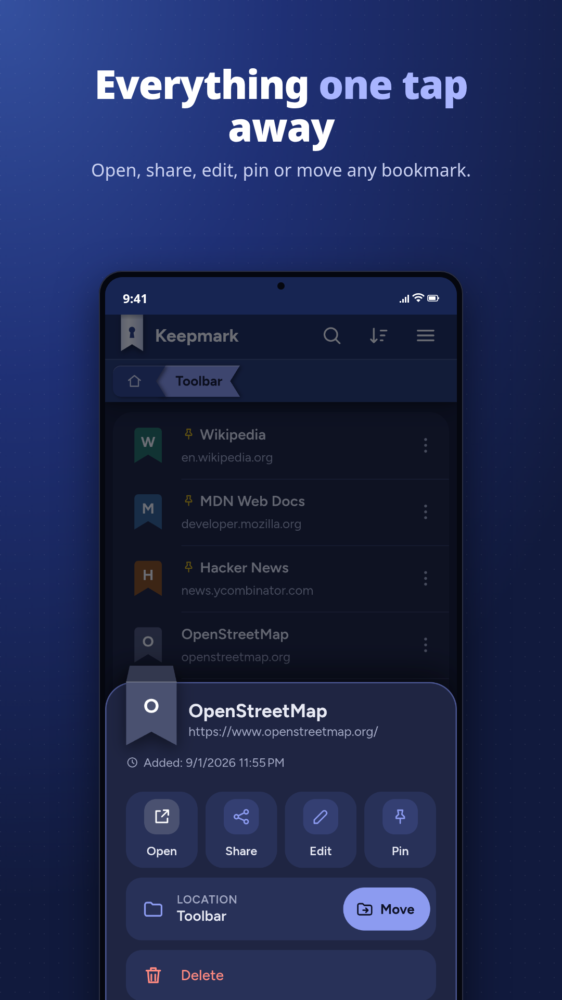
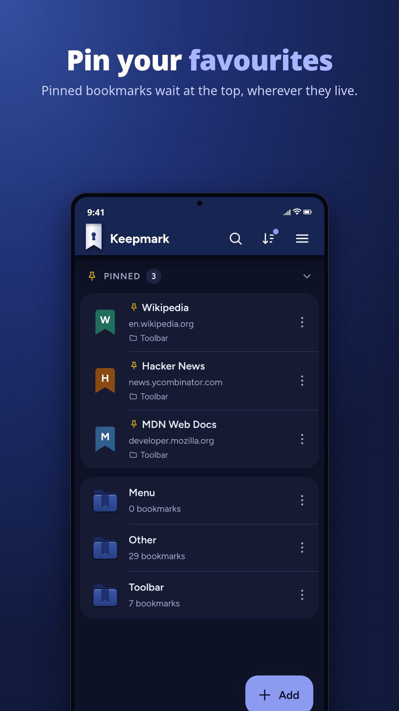

<p align="center">
  
</p>

<h1 align="center">Keepmark for Android</h1>

<p align="center">
  <b>Your bookmarks on your phone, synced and end-to-end encrypted.</b><br />
  An independent app compatible with xBrowserSync.
</p>

<p align="center">
  
  
  
</p>

<p align="center">
  
</p>

---

Keepmark keeps the same bookmarks on your browsers and your phone. Everything
is encrypted on the device before it leaves: the service that stores your
data sees only ciphertext, and your password never leaves the phone.

It works with **any xBrowserSync service** (the official one, a community
host or your own) and with the official xBrowserSync apps. A sync created in
Keepmark opens there, and the other way round. Nothing to migrate.

## Highlights

- **Private by design.** PBKDF2-SHA256 and AES-GCM on the device. The local
  database is encrypted too (SQLCipher), and the credentials live in the
  Android KeyStore. No telemetry, HTTPS-only services.
- **Never lose a bookmark silently.** Conflicts are never resolved behind
  your back: you pick download, upload or merge, and merge shows a preview
  first. Before every destructive step Keepmark saves an encrypted safety
  backup you can restore.
- **Made for the phone.** Fast full-text search, pinned bookmarks, a
  clickable breadcrumb, folders first, swipe for details and one menu for
  every action.
- **Share to Keepmark** from any app: the add form opens already filled in.
- **App lock** with fingerprint or device PIN, with a relock time you choose.

## Features

| | |
|---|---|
| **Sync** | Automatic or manual, with clear status and honest conflict handling |
| **Browse** | Search, pinned section, breadcrumb, folder tree picker |
| **Edit** | Add, edit, move and delete bookmarks and folders, with undo |
| **Backup** | Encrypted export and import, compatible with Keepmark for browsers |
| **Safety backups** | Automatic snapshot before every destructive step (newest 5 kept) |
| **Duplicates** | Find links saved more than once; one copy of each always survives |
| **Move service** | Move your bookmarks to another service, into a new or existing sync |
| **Look and feel** | Light, dark or system theme; English, Italiano, Français, Español, Deutsch, 日本語, Português (Brasil), Русский, 简体中文 |
| **Logs** | Built-in viewer with share export, sync IDs and secrets redacted |

With **Keepmark Server** you also get revision-based conflict detection,
faster "nothing changed" checks and the option to delete your sync from the
server. On other services Keepmark falls back automatically.

## Screenshots

<p align="center">
  
  
  
  
</p>

<p align="center">
  
  
  
</p>

## The Keepmark family

| | |
|---|---|
| **Keepmark for Android** | This app (Android 10+) |
| **Keepmark for browsers** | Extension for Firefox and Chromium-based browsers (Chrome, Edge, Brave) |
| **Keepmark Server** | Drop-in xBrowserSync-compatible sync service with opt-in extended features |

All three share the same encryption, the same backup format and the same
wording, so moving between them feels the same.

## Compatibility

- **Services:** any xBrowserSync API service, version 1.1.9 or later.
- **Clients:** syncs open both ways with the official xBrowserSync apps
  (sync format 1.8.0). The encryption is verified byte for byte against the
  official implementation.
- **Device:** Android 10 (API 29) or later.

## Get it

Download the APK from the
[latest release](https://github.com/Keepmark/KeepmarkMobile/releases/latest)
(all versions: [Releases](https://github.com/Keepmark/KeepmarkMobile/releases)).
Project home: <https://github.com/Keepmark>.

## Build from source

Requirements:

- .NET 10 SDK with the MAUI Android workload: `dotnet workload install maui-android`
- JDK 21 (newer JDKs are rejected by the Android build with `XA0030`)
- Android SDK with platform-tools

Point the build at the JDK and the SDK (adjust the paths):

```sh
export JAVA_HOME=$HOME/jdk-21
export ANDROID_HOME=$HOME/android-sdk ANDROID_SDK_ROOT=$HOME/android-sdk
export PATH=$JAVA_HOME/bin:$ANDROID_HOME/platform-tools:$PATH
```

From the repository root:

```sh
dotnet test                                           # Core unit + crypto interop tests
dotnet build src/KeepmarkMobile -f net10.0-android -c Debug
```

Run the Debug build on a connected device or emulator (Debug uses Fast
Deployment, so install it this way, not with `adb install`):

```sh
dotnet build src/KeepmarkMobile/KeepmarkMobile.csproj -t:Run -f net10.0-android -c Debug
```

Build a self-contained APK that installs with `adb install` or by opening it
on the phone:

```sh
dotnet publish src/KeepmarkMobile -f net10.0-android -c Release -p:AndroidPackageFormats=apk
```

The APK lands in `src/KeepmarkMobile/bin/Release/net10.0-android/publish/`
(`com.keepmark.mobile-Signed.apk`). Without the maintainer's upload key it
is signed with the local debug key, so it cannot update an install from
Releases or Google Play: uninstall that one first.

More detail (device setup, version bumps): [developer guide](docs/DEVELOPMENT.md).

## Documentation

- [Developer guide](docs/DEVELOPMENT.md): build environment, architecture,
  engineering rules, safety-backup specification.
- [Verification spec](docs/verification-spec.md): behavioural requirements
  for code review.
- [Workflows](docs/WORKFLOWS.md) and [UI terms](docs/UI-TERMS.md): shared
  with Keepmark for browsers.

## Feedback

Questions, bug reports and ideas: [open an issue](../../issues).

## License

Proprietary — © 2026 Yari Melzani, all rights reserved. See
[`LICENSE.md`](LICENSE.md).

Independent implementation, written from scratch; compatible with the
xBrowserSync protocol. Not affiliated with or endorsed by xBrowserSync.

Third-party notices: `Crypto/LzUtf8.cs` is a C# port of `lzutf8` (MIT,
© Rotem Dan, notice kept in the file); BouncyCastle (MIT).

## Disclaimer

Keepmark is provided "as is", without warranty of any kind, express or
implied, including the implied warranties of merchantability and fitness for
a particular purpose. Use it at your own risk: the authors are not liable for
any loss of data (including bookmarks), damage or other consequences arising
from its use. See `LICENSE.md`. Keep your own backups.
